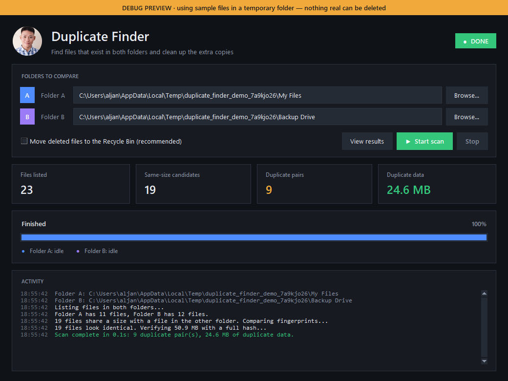
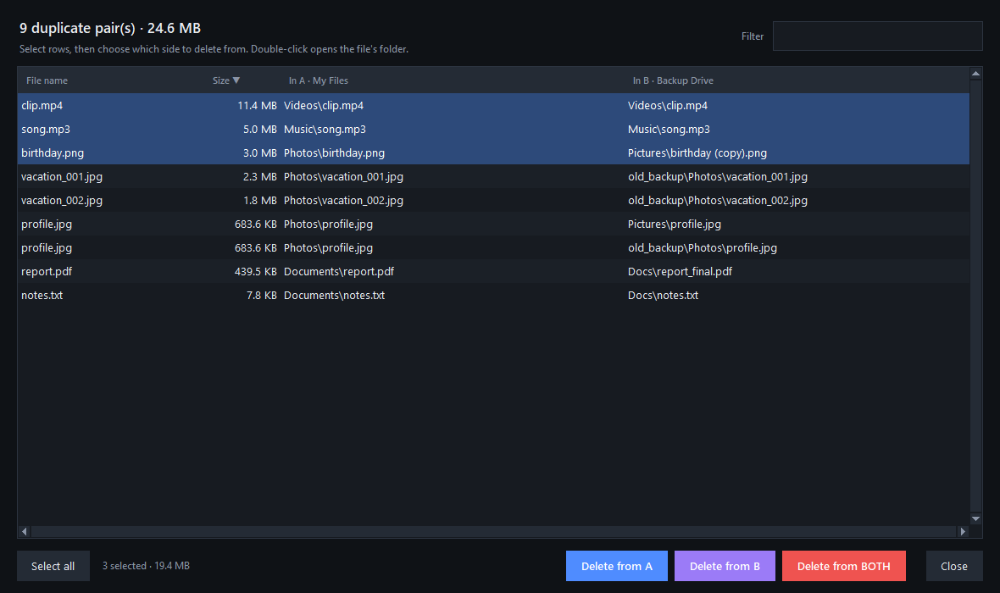

# FinderApp — Duplicate Finder

Compare two folders or drives, find the files that exist in **both**, and clean up the extra copies.

Useful when you have a backup drive and your main drive and want to know what's already backed up, or free up space by removing copies you no longer need.



> [!WARNING]
> Vibe coded with AI, so expect bugs. This app deletes files. Try it in [debug preview](#try-it-safely-debug-preview) first, keep backups, and use it at your own RISK!

## Features

- **Exact matches only.** Files are compared byte-for-byte using a hash, not by name or date. A renamed copy like `birthday (copy).png` is still found; two different files with the same name are not.
- **Fast on big drives.** Files are first grouped by size, then by a quick fingerprint of their first 64 KB, and only the remaining likely matches are fully hashed. Both folders are scanned in parallel.
- **Safer deleting.**
  - Deleted files go to the Recycle Bin by default.
  - "Delete from A" only removes a file if its copy in B still exists (and the other way round).
  - Choosing the same folder twice, or a folder inside the other, is blocked so a file can never be matched with itself.
- **Results you can work with.** Sort by size to find the biggest wins, filter by name, double-click to open the file's folder in Explorer, right-click to copy a path.
- **Debug preview** with sample files, so you can try everything without touching real data.



## Getting started

You need [Python](https://www.python.org/downloads/) 3.10 or newer (tested on 3.14) and Pillow:

```
pip install pillow
python DuplicateCheck_11.py
```

### Try it safely (debug preview)

```
python DuplicateCheck_11.py --demo
```

This creates two sample folders full of fake duplicates in your temp folder, fills them in for you, and deletes them when you close the app. You should get **9 duplicate pairs**. The sample set also includes two zip files that look alike (same size, same start) and some empty files; those must **not** show up.

In VS Code, open **Run and Debug** (Ctrl+Shift+D) and pick **Duplicate Finder: Debug preview (sample files)**.

## How to use it

1. Click **Browse…** to choose **Folder A** and **Folder B**.
2. Click **Start scan**. You can **Stop** at any time.
3. When it's done, the results window opens with every file that exists in both folders.
4. Select rows (Ctrl/Shift-click, or **Select all**), then choose:
   - **Delete from A** — removes the copy in Folder A and keeps Folder B's.
   - **Delete from B** — removes the copy in Folder B and keeps Folder A's.
   - **Delete from BOTH** — removes **every** copy. Nothing is left in either folder, so you'll get an extra warning first.

### About the Recycle Bin

"Move deleted files to the Recycle Bin" is on by default, so you can restore mistakes. Two exceptions:

- **Network drives** (like a mapped `Z:` drive) have no Recycle Bin, so Windows deletes files there permanently.
- If you untick the box, files are deleted permanently.

## Building the .exe

```
pip install pyinstaller
pyinstaller DuplicateCheck_11.spec
```

The app is created at `dist/DuplicateCheck_11.exe`. It includes the profile picture and opens without a console window.

## Good to know

- It only finds files that are in **both** folders. Duplicates inside a single folder are not reported.
- Empty (0-byte) files are skipped, since they would all match each other.
- Files you don't have permission to read are skipped quietly.
- The Recycle Bin, Explorer and dark title bar features are Windows-only. The rest works on macOS and Linux, but deleting is always permanent there.

## Project files

| File | What it is |
| --- | --- |
| `DuplicateCheck_11.py` | **The current app.** |
| `DuplicateCheck_11.spec` | PyInstaller build settings for the current app. |
| `DuplicateCheck_*.py`, `DuplicateChecker*.py` | Earlier versions, kept for reference. |
| `docs/` | Screenshots used in this README. |

Made by SpeedGamer21.
